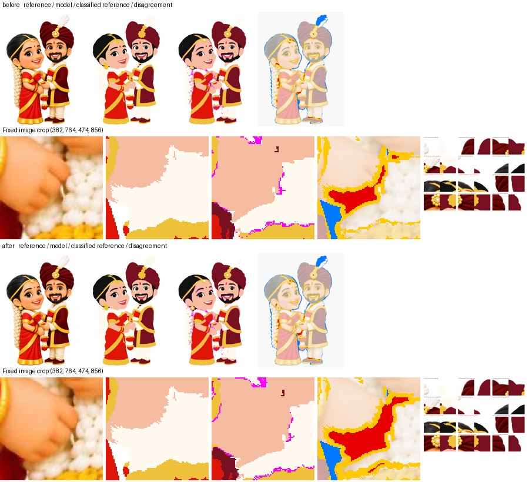
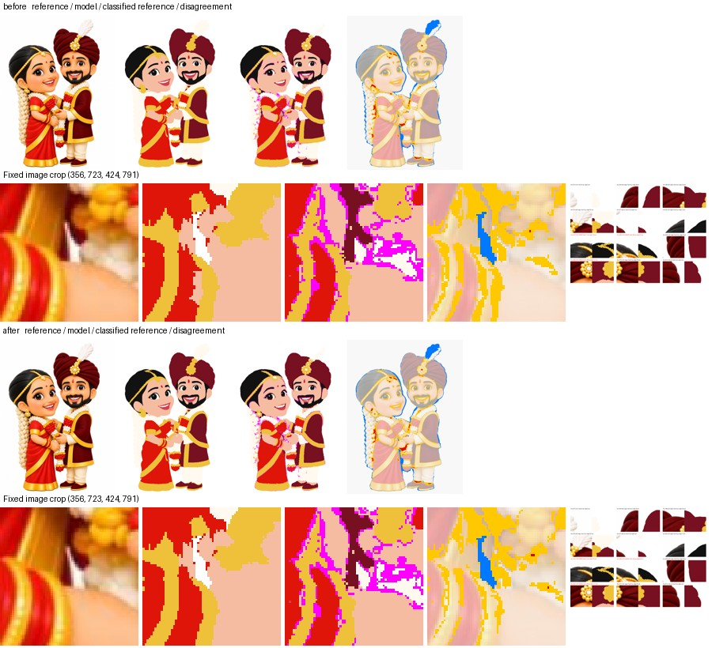
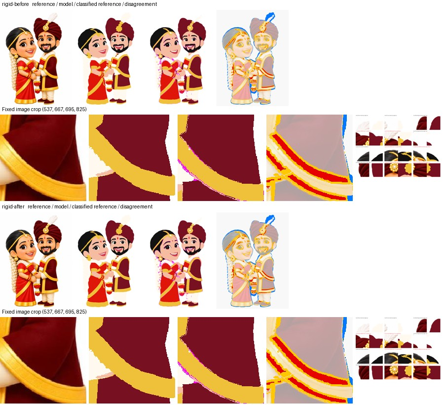
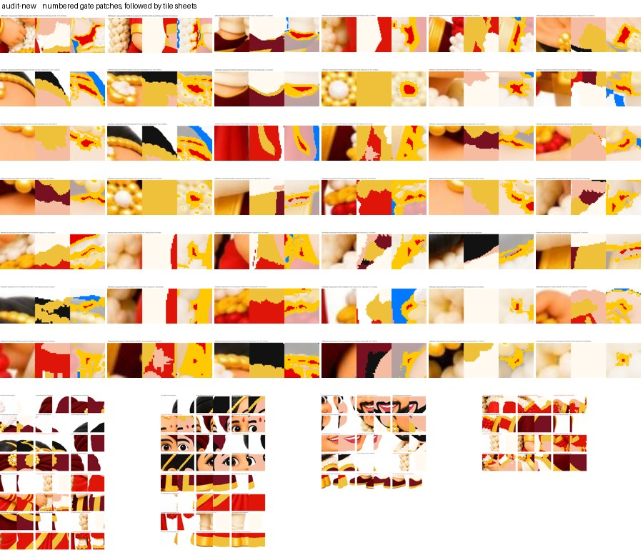

# Which audit edits reached the front?

Hypothesis: the two-scale vote can copy an adjacent material at a visible contact. Decode the reviewed guide and audit candidate and intersect changed face IDs with each gate patch. The locked camera comes from the existing round-one practice run, so these values can differ from earlier independently fitted values.

Run from the repository root after [baseline setup](../ENVIRONMENT.md). Measurements use the locked Python environment and the repository gate.

```sh
python "codex works/experiments/2026-11-18-audit-overlap/run.py" "$scratch/audit-overlap"
```

| Arm | Verdict | Disagreement % | Largest clear mm² | Review patches | Boundary p95 mm | Silhouette IoU | Ambiguous % | Seconds |
|---|---|---:|---:|---:|---:|---:|---:|---:|
| before | FAIL | 0.8594 | 16.229 | 4 | 0.688 | 0.9516 | 2.701 | 7.97 |
| after | FAIL | 0.9316 | 22.924 | 3 | 0.687 | 0.951 | 2.701 | 6.92 |



Of 1669 changed triangle labels, 168 were visible at the reference resolution and 1501 were unobserved. The gate's reported patches contained 0 distinct edited IDs before and 0 after. On pixels directly on edited faces, 0 disagreements appeared and 0 resolved. On other pixels, 1128 appeared and 782 resolved. The gate recalculates the optical flow and exclusion band around paint edges. A neighboring pixel can change status even when its triangle label stays fixed.



**Verdict. Reject automatic application on this model.** Use the audit as a proposal list. Check affected visible triangles against the corresponding approved view and retain unobserved changes for another view or owner review. Geometry and face ordering matched exactly across the decoded 3MFs. The gate self-tests at 30 and 1,500 planted faces both passed on the baseline. No referee code changed in this test. The complete per-patch intersection counts and per-slot transitions are in [results.json](results.json).

### Registration control

| Arm | Verdict | Disagreement % | Largest clear mm² | Review patches | Boundary p95 mm | Silhouette IoU | Ambiguous % | Seconds |
|---|---|---:|---:|---:|---:|---:|---:|---:|
| rigid-before | CANNOT_JUDGE | 3.754 | 31.928 | 4 | 1.567 | 0.9426 | 2.701 | 9.23 |
| rigid-after | CANNOT_JUDGE | 3.754 | 31.89 | 4 | 1.567 | 0.9426 | 2.701 | 8.92 |



With local alignment disabled both arms have identical disagreement to four decimal places and sufficiently poor silhouette agreement to be unjudgeable. In the adaptive crop at the hand and flowers the skin/ivory model boundary is stable, while the classified reference and hard region move. This accounts for the score difference without establishing that the hidden labels are correct. The densest visible edit neighborhood is around the wrist and bangle.


