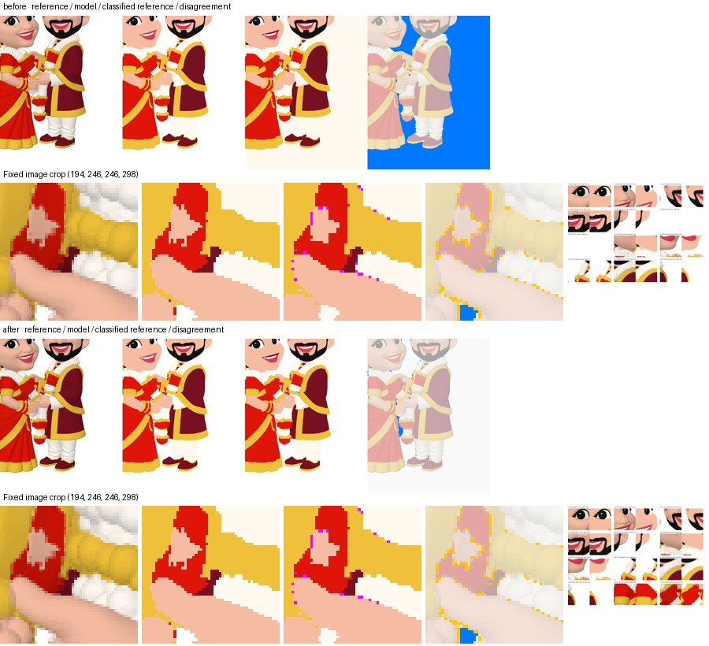
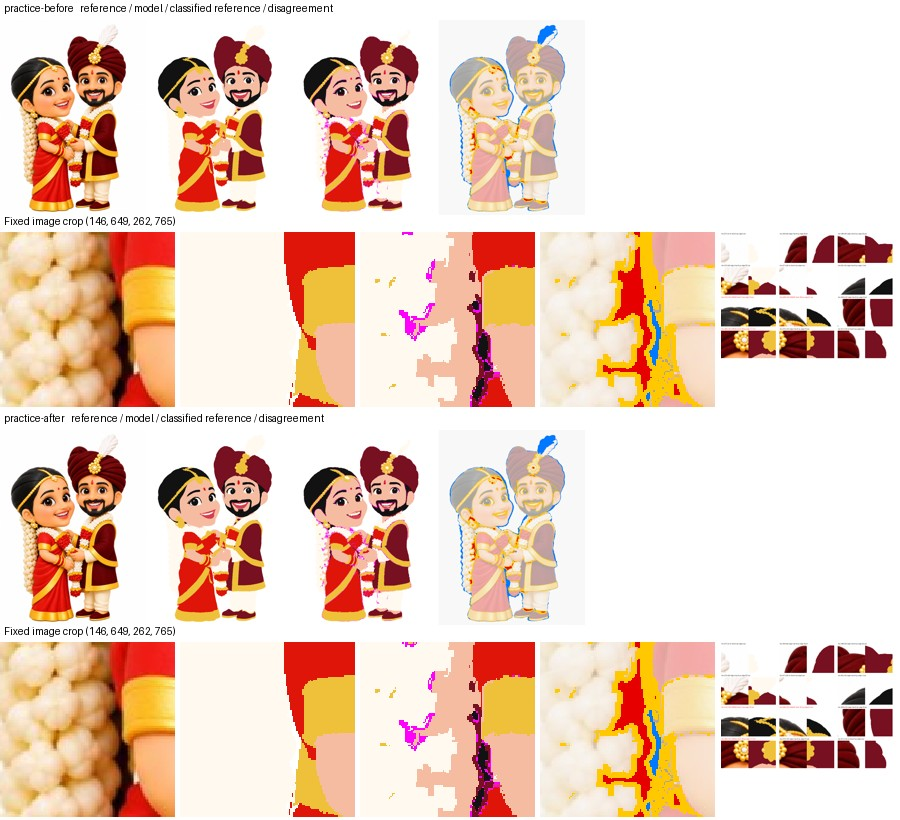
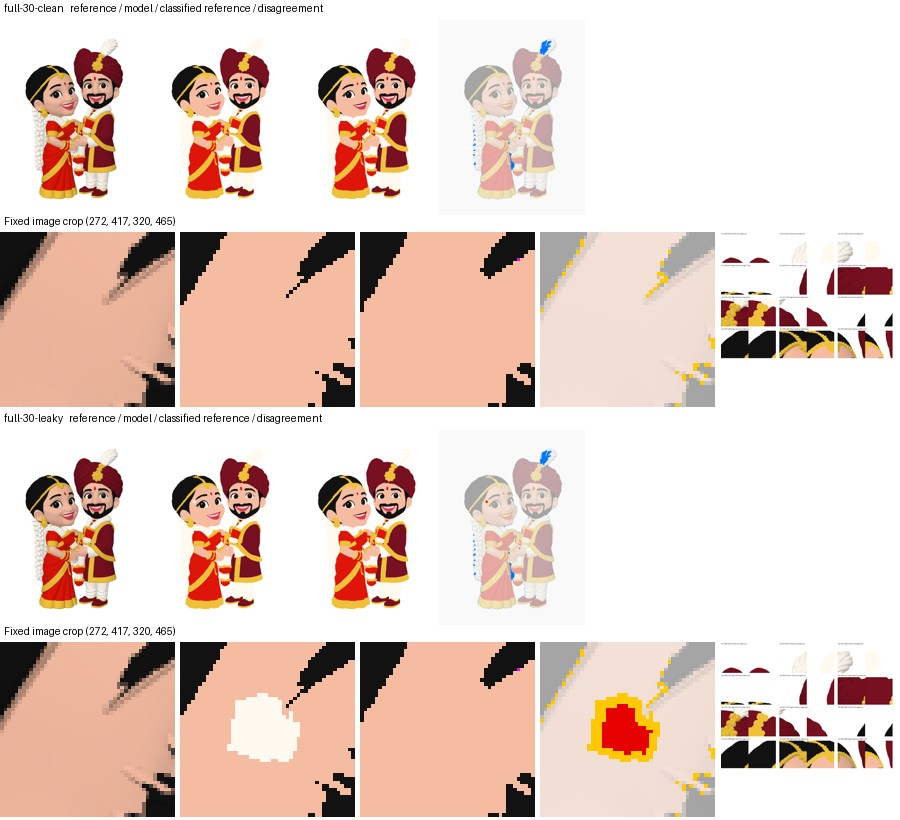
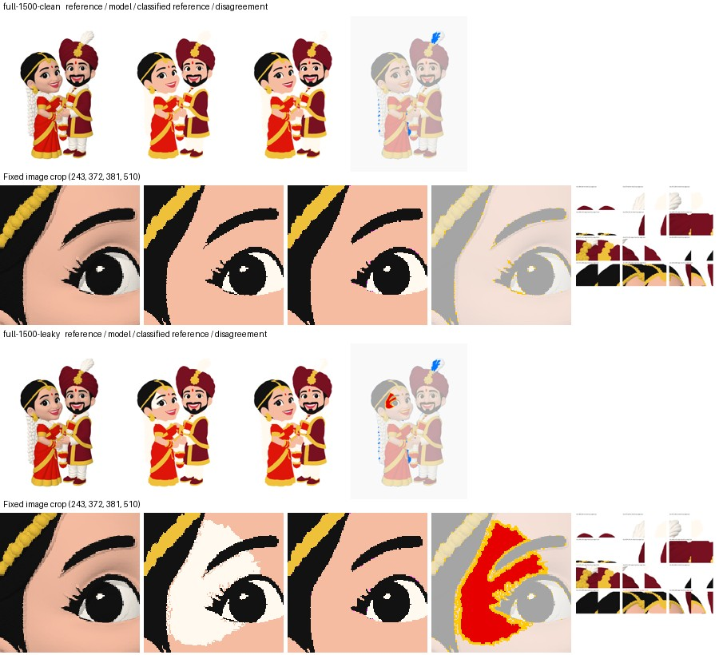
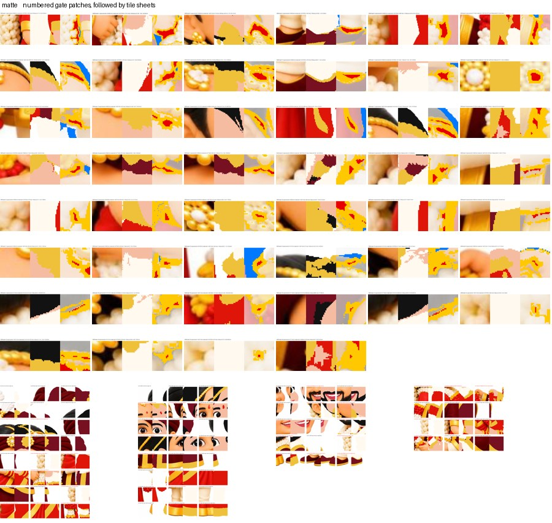

# Can the upper-left flood seed invalidate a correct model?

Hypothesis: if a white-background reference is cropped through the figurine at the seed pixel, the background flood can classify exterior space as foreground. Pass the same algorithm a ten-pixel white border, then remove the border and give the resulting mask to the stock referee.

Run from the repository root after [baseline setup](../ENVIRONMENT.md). Measurements use the locked Python environment and the repository gate.

```sh
python "codex works/experiments/2026-11-18-corner-matte/run.py" "$scratch/corner-matte" "$scratch/s30"
```

| Arm | Verdict | Disagreement % | Largest clear mm² | Review patches | Boundary p95 mm | Silhouette IoU | Ambiguous % | Seconds |
|---|---|---:|---:|---:|---:|---:|---:|---:|
| before | CANNOT_JUDGE | 0.0 | 0.0 | 0 | 0.156 | 0.5244 | 0.144 | 4.11 |
| after | PASS | 0.0 | 0.0 | 0 | 0.156 | 0.991 | 0.243 | 3.58 |



The full-frame control used the unchanged wedding judge, its 25 anchors, and the same fixed camera.

| Arm | Verdict | Disagreement % | Largest clear mm² | Review patches | Boundary p95 mm | Silhouette IoU | Ambiguous % | Seconds |
|---|---|---:|---:|---:|---:|---:|---:|---:|
| practice-before | FAIL | 0.8594 | 16.229 | 4 | 0.688 | 0.9516 | 2.701 | 7.61 |
| practice-after | FAIL | 0.8529 | 15.964 | 2 | 0.688 | 0.9513 | 2.715 | 7.42 |



For the cropped regression image the top-left pixel lies on the figurine. The original fill estimated 100.00% foreground, the padded fill 52.83%. We translated the saved camera by crop origin [288, 432] pixels and kept it fixed. For the full-frame 30/1,500-face controls we reused their solved cameras and reran clean and planted cases with the candidate masks. See [the exact verdict and patch-ID comparisons](results.json).




The padding assumes a known white background. For a different background, alpha or a vetted mask is preferable. Cropping removes evidence for every excluded surface. An invisible white feature touching pure white still needs alpha, another view, or a mask supplied with the art.

**Adopt for the cropped, known-white case.** The large blue exterior disappears in the after view. Both full-frame face defects remain localized by the gate. A padded full portrait offers no silhouette advantage. The standalone helper took 1.00 s including startup on the regression crop and produced exactly the bytes used for the mask in the experiment. It uses the existing pinned OpenCV environment, with no new model or service. Inspect the generated mask once before passing it to the gate.


