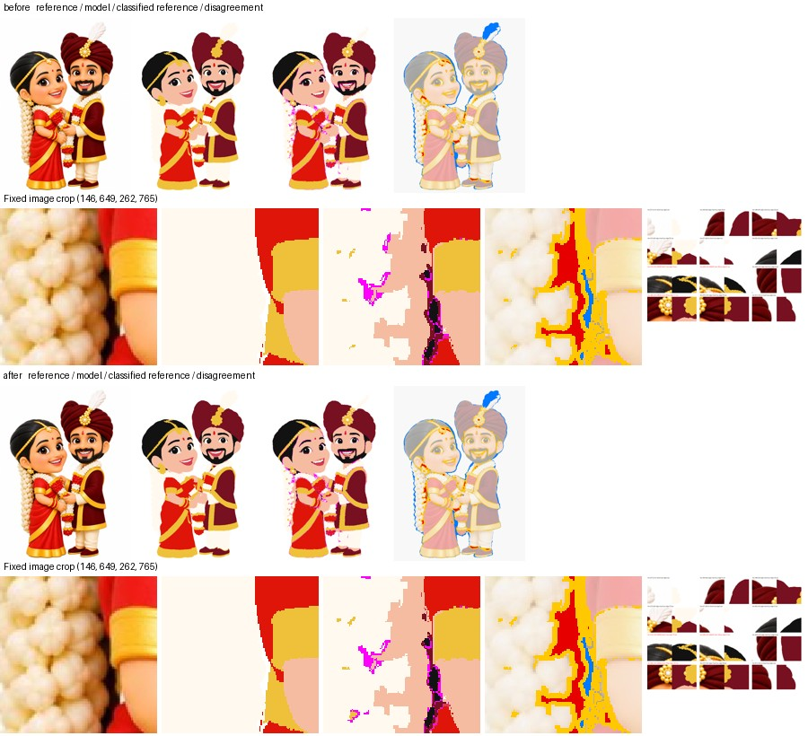
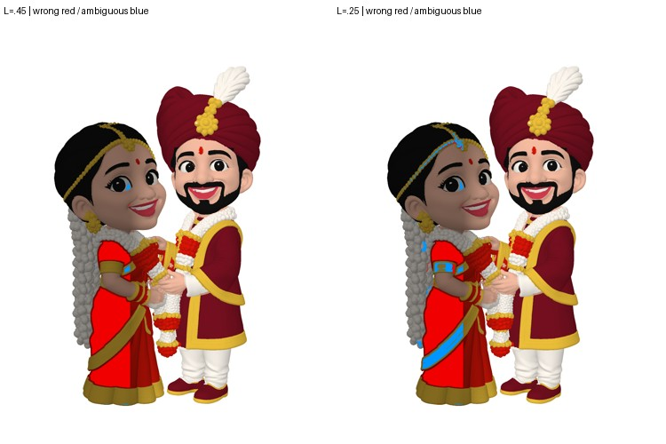
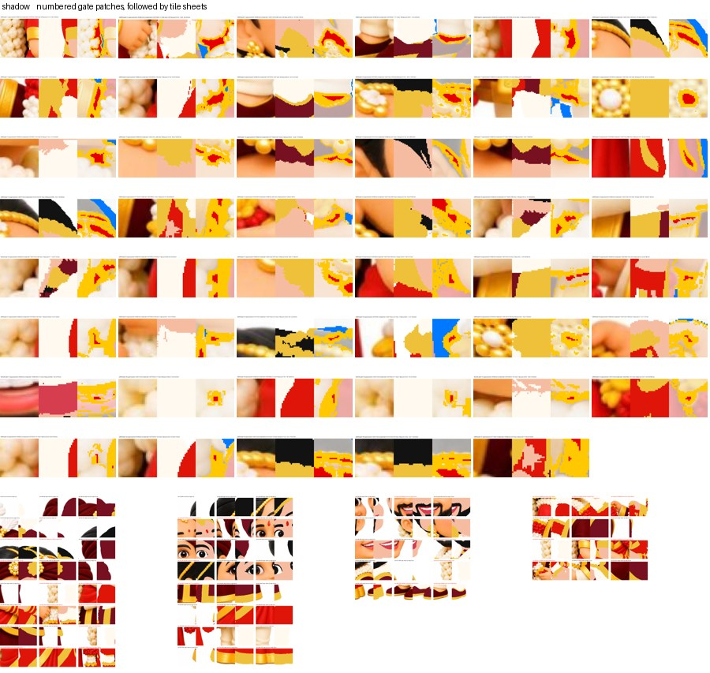

# Does reducing L* weighting make the gate more reliable?

Hypothesis: reducing the L* coefficient from 0.45 to 0.25 could distinguish shadowed warm colors. The input guide, approved image, all 25 anchors, camera, segmentation and gate thresholds remain fixed. Only a scratch copy of the classifier changes. No weights were fitted to the judge.

Run from the repository root after [baseline setup](../ENVIRONMENT.md). Measurements use the locked Python environment and the repository gate.

```sh
python "codex works/experiments/2026-11-18-shadow-weight/run.py" "$scratch/shadow-weight" "$scratch/s30"
```

| Arm | Verdict | Disagreement % | Largest clear mm² | Review patches | Boundary p95 mm | Silhouette IoU | Ambiguous % | Seconds |
|---|---|---:|---:|---:|---:|---:|---:|---:|
| before | FAIL | 0.8594 | 16.229 | 4 | 0.688 | 0.9516 | 2.701 | 7.09 |
| after | FAIL | 0.8865 | 16.399 | 4 | 0.715 | 0.9516 | 2.529 | 7.25 |



The scratch challenger ran the original 30-face and 1,500-face self-test programs. Their return codes (zero means clean PASS and planted leak detected at the right location) and timings were {'30': {'returncode': 0, 'seconds': 133.26}, '1500': {'returncode': 0, 'seconds': 121.9}}.

As a second test we cast a known synthetic shadow across the regression reference, compared the left-side interior against depth-tested labels at the generator camera, discarded a three-pixel rim, and counted abstentions separately. Both arms see identical pixels. Pure-background pixels are excluded.

| L* weight | Interior pixels | Correct | Wrong | Ambiguous |
|---|---:|---:|---:|---:|
| L=.45 | 102832 | 76040 | 26348 | 444 |
| L=.25 | 102832 | 69108 | 26752 | 6972 |



**Reject as a default.** The practice classifier at 0.25 assigned more pixels confidently but disagreement and boundary p95 both worsened. In the flower/sleeve crop the darker reference beads still acquire an inconsistent material label. The clean synthetic control also reported a small patch while retaining PASS. Keep the existing 0.45 coefficient until performance improves on independent shadowed references.


