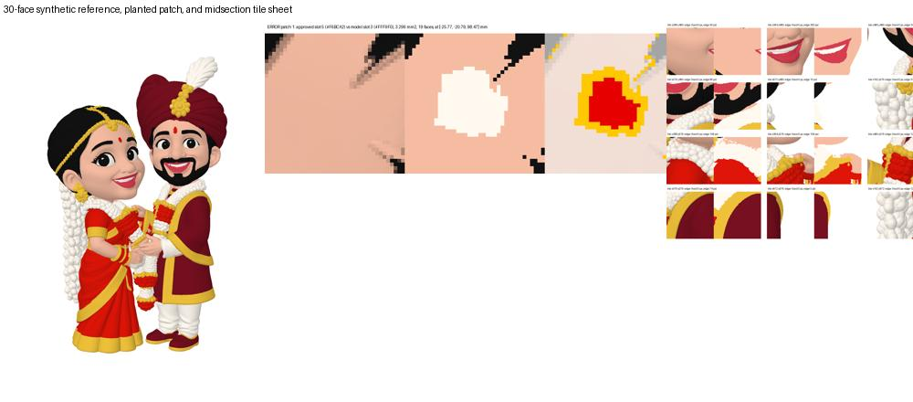

# Reproducing the November 18 sprint

Start from PR #1's unmerged branch at `47a9e9b906e5fb602cd00009369ad64985e82ba0`. All paths in the commands are relative to repository root. Use a fresh scratch directory with several GB free. The reviewed replay requires its destination to be empty.

On Debian the runtime packages are `libegl1 libegl-mesa0 libgl1-mesa-dri libgles2 libopengl0 libglu1-mesa`. Five were installed system-wide on the sprint host. The account had no root access. The matching Debian package `libgles2_1.7.0-1+b2_amd64.deb` was extracted with `dpkg-deb -x` and its `usr/lib/x86_64-linux-gnu` directory prepended to `LD_LIBRARY_PATH`. The project ran in a Python 3.12 venv.

```sh
python -m pip install -r wedding-u1-skill/reviewed/requirements.txt
python -m pip check
python wedding-u1-skill/scripts/replay.py "$scratch/flat"
python wedding-u1-skill/scripts/verify.py "$scratch/flat"
python wedding-u1-skill/reviewed/replay.py "$scratch/reviewed"
for size in 30 1500; do
  python -I wedding-u1-skill/coloring/approved_match_selftest.py Wedding-150mm-reviewed-paint-guide.3mf "$scratch/s$size" --patch-faces "$size"
done
python scoreboard/score.py run wedding-couple --practice
```

The experiments reuse the existing pinned environment. They introduce no model weights, hosted APIs or additional Python packages. OpenCV supplies the connected-region flood fill. Its documentation describes filling a connected component from a seed pixel, and its implementation accepts one seed per call. The corner experiment tests the consequence of choosing that pixel on the figurine. [OpenCV documentation](https://docs.opencv.org/4.x/d7/d1b/group__imgproc__misc.html) · [OpenCV implementation](https://github.com/opencv/opencv/blob/4.x/modules/imgproc/src/floodfill.cpp) · [OpenCV license](https://github.com/opencv/opencv/blob/4.x/LICENSE)

The repository research note already distinguishes brush paint from sliced wall colors. Our checks here stop at the exported finish guide and its rendered labels. Reddit search returned HTTP 403 during this sprint. No forum anecdote is used as measurement evidence.

The OpenCV project reports Apache-2.0. No new research model or training data was downloaded. The reviewed replay uses the repository's existing pinned dependency set, including the mesh-repair packages. This sprint makes no additional licensing claim for redistribution of those packages.



| Check | Result | Wall time |
|---|---|---:|
| pip check | No broken requirements | — |
| Flat replay | Completed | 164 s |
| Flat verifier | 2 archive contents and 4 PNGs matched | 2 s |
| Reviewed replay | Every member matched both published archives | 104 s |
| Stock 30-face self-test | Clean PASS, leak FAIL, location error 0.39 mm | 122 s |
| Stock 1,500-face self-test | Clean PASS, leak FAIL, location error 0.80 mm | 122 s |
| Wedding practice scoreboard, round 2 | Completed, model verdict FAIL | 66 s |

The registered Codex contour submission scored 0.6953% disagreement, 17.193 mm² largest clear error, 3 review patches, 0.604 mm boundary p95 and 0.9513 silhouette IoU. Its local alignment reached the 2 mm cap. The plume has low contrast against the white background. The error overlay also shows large silhouette offsets along the side of the bride. The experiment comparisons use the older reviewed guide with matching face IDs, a necessary input for tracing the 1,669 recorded edits.


PR #1 merged while the tests were running, at 17:51:19 UTC. The merged main commit `f18bb413851d4b0caa3fdd82a999054b0e0d0a3f` and the tested starting commit have the identical Git tree `b3d6cbe26a179a3107908bbdc93efb73cac0f6d0`. The published sprint commit uses that merged main as parent.
