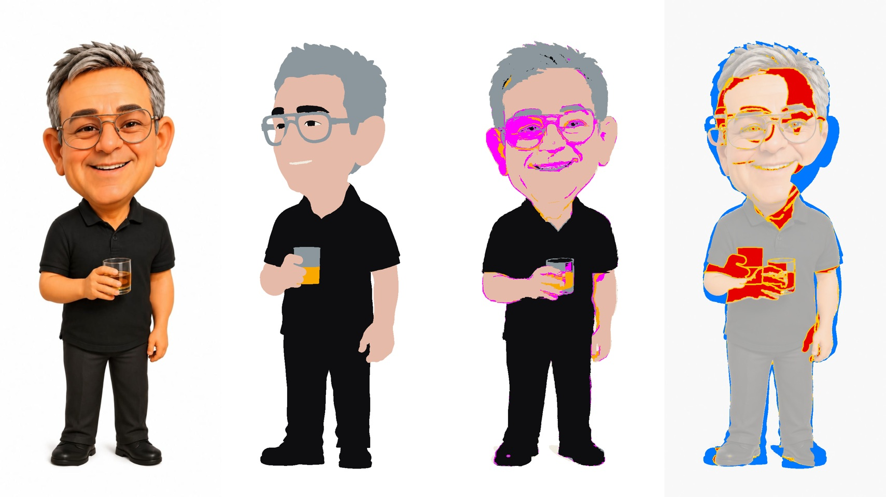

# Customer-approved front portrait · 20 November 2026

The owner identified the attached portrait as customer-approved. Visual inspection matches the repository's 712 × 1,600 front photo (SHA-256 edf44d31a406e7a4a6f0f679b01c2b58c1a8d631d8b1e337bb09916eead89ceb). The Drive link supplies a different U1 project from the archived revision. Incoming SHA-256 c23c5cdfa4353d72304c884c5fe4cab0fb83dd8b513b233bffef9aa26aaedc99.

The incoming mesh contains 1,022,128 painted triangles and measures 73.681 × 78.470 × 220.000 mm. I decoded the four paint codes. For the intended finish I interpreted head 4 below the project's 120 mm swap as orange and above it as white. Across the full extents of those triangles, orange ends at 106.000 mm and white starts at 158.656 mm. This verifies finish mapping for this upright geometry only.

The stock referee solved the camera against the repository portrait and used the existing man-with-drink anchors. Verdict **CANNOT_JUDGE**. Silhouette IoU 0.9018, ambiguous 6.738%, disagreement 10.4883%, largest clear region 238.766 mm², boundary p95 3.672 mm. Reasons: silhouette IoU 0.902 < 0.95: pose or geometry differs; supply a mask or camera.

The photo shows a transparent tumbler with an amber drink, warm skin and gray hair with darker strands. The documented print palette uses silver for the glass and hair, orange for the liquid, and apricot for skin. Customer approval applies to the portrait. This comparison does not constitute customer acceptance of those substitutions or of the print. The front image provides no direct evidence for the back. No slicer, G-code or physical print check was performed.

